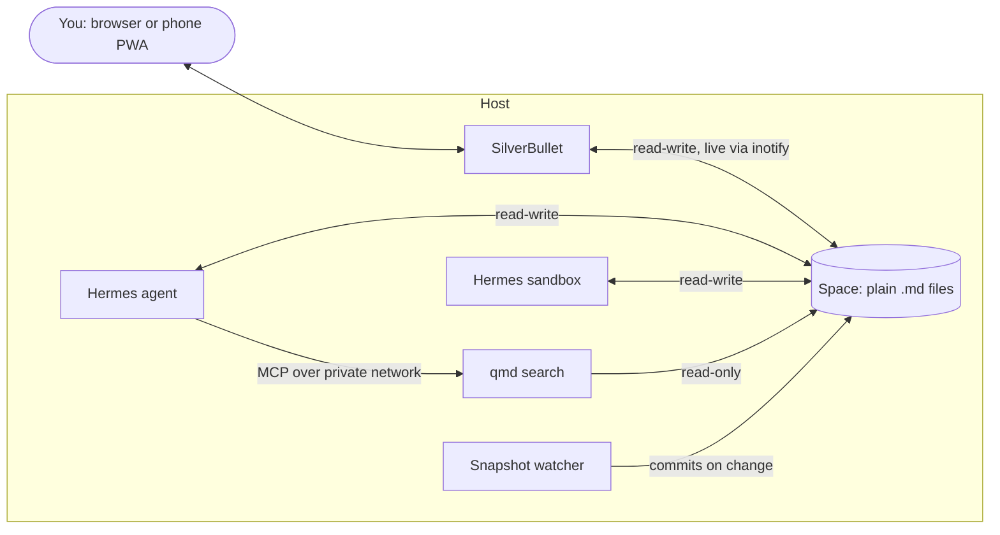

# hermes-silverbullet

Give [Hermes Agent](https://github.com/NousResearch/hermes-agent) a shared,
human-readable knowledge base: a [SilverBullet](https://silverbullet.md) space
that the agent edits with its ordinary file tools, and you watch update live in
your browser or on your phone.

There is no plugin and no MCP adapter. The space is just a directory of
markdown files, mounted into the agent's container. Everything interesting
comes from three properties that combine well:

1. **Plain files on disk.** SilverBullet stores one `.md` file per page with no
   database, so `read_file`, `patch` and `git` work on notes directly.
2. **Live in both directions.** SilverBullet watches the space with inotify, so
   a note the agent writes appears in an open editor without a reload. A note
   you type on your phone can be read by the agent a second later.
3. **Pages can be queries.** SilverBullet's `${query[[...]]}` blocks turn
   tags and frontmatter into live dashboards. Have the agent write structured
   frontmatter (`status: open`, `area: billing`) and its output sorts itself
   into views you never have to maintain.



It is a kit of parts rather than an installer: copy what you want.

## What's here

| Path | What it is |
| --- | --- |
| [`compose.yaml`](compose.yaml) | SilverBullet, Hermes and qmd on one host, sharing the space |
| [`scripts/prepare-space.sh`](scripts/prepare-space.sh) | One-time ownership, default ACL and git setup for the space |
| [`scripts/snapshot-watch.sh`](scripts/snapshot-watch.sh) | Commits the space to git when it changes (SilverBullet has no page history), with a [systemd unit](scripts/silverbullet-snapshot-watch.service) |
| [`hermes/config.snippet.yaml`](hermes/config.snippet.yaml) | The `config.yaml` pieces: sandbox mount and qmd MCP server |
| [`hermes/SOUL.snippet.md`](hermes/SOUL.snippet.md) | The one paragraph of persona that makes the agent use the vault |
| [`skills/`](skills/) | Two Hermes skills: how to edit the vault, how to search it |
| [`vault/Hermes/_index.md`](vault/Hermes/_index.md) | A dashboard page for the agent's folder |
| [`qmd/`](qmd/) | Image, index config and hourly refresh for local hybrid search over the vault |

## Quick start

```bash
sudo ./scripts/prepare-space.sh /srv/silverbullet/space 1000
cp .env.example .env    # set SB_USER and choose versions
docker compose up -d
```

Then:

1. Merge [`hermes/config.snippet.yaml`](hermes/config.snippet.yaml) into
   Hermes' `config.yaml` and restart the gateway.
2. Append [`hermes/SOUL.snippet.md`](hermes/SOUL.snippet.md) to `SOUL.md`,
   filling in the name. Start a session with `/new` to pick it up.
3. Copy [`skills/`](skills/) into `/opt/data/skills/`.
4. Copy [`vault/Hermes/_index.md`](vault/Hermes/_index.md) into the space.
5. Install `inotify-tools`, then enable the snapshot watcher from
   [`scripts/silverbullet-snapshot-watch.service`](scripts/silverbullet-snapshot-watch.service).
6. Add `qmd/refresh.sh` to the host's crontab (`47 * * * *`).

## Why SilverBullet and not Obsidian

The requirements were a real phone experience (offline-capable), notes stored
as plain markdown on disk, and no database. SilverBullet is a PWA with full
offline sync and meets all three.

Obsidian does not meet the middle one when self-hosted. Its sync stores chunked,
optionally encrypted blobs, and every agent route into an Obsidian vault that
I found, including the community MCP servers, needs a *running Obsidian
client*. That means a GUI desktop app in a VNC container as production
infrastructure.

## Design decisions

### The vault is shared, so the agent says what it wrote

The persona snippet tells the agent three things: the vault is the user's
knowledge base and not its memory; it should capture hard-won knowledge
there **without being asked**; and it must **always say what it wrote and
where**. Session recall belongs in Hermes' memory provider (Honcho, in the
original setup), while durable reference material goes in the vault.

Capture is aimed at the things that are expensive to rediscover: a decision
and its reasoning, a gotcha that took an hour to diagnose, a measurement. It
is not a session log, and the snippet says so, because without that line the
agent narrates.

### Its own folder, for tidiness rather than permission

The agent writes under `Hermes/` by default, so its notes can be reviewed or
pruned as a group. Nothing confines it there: it is told to append to an
existing note of yours when that note already covers the topic, rather than
starting a parallel one you would later merge by hand.

The safeguard is **disclosure plus history**, not restriction. Every edit is
announced in the chat, and a git snapshot taken when the space changes makes it
recoverable.

### Frontmatter is the interface

Because SilverBullet queries frontmatter, anything the agent produces on a
schedule can land as one note per item with a `status:` key. A dashboard query
then lists the open ones, and you close an item by editing one line in the
same editor you take notes in. One note per item matters: each can be
handled without touching the others.

The same trick gives a recurring job state without a state file. If each run
records what it covered (`area: <package>`) in its note's frontmatter, the
next run can read the folder and pick the area visited least recently.

### Search is a fallback, and it is local

Hermes has no built-in document retrieval, so a vault past a few dozen pages
needs search. [qmd](https://github.com/tobi/qmd) does BM25, vector and
optional LLM reranking entirely on-device, and serves it over MCP.

Measured honestly: on a small corpus, `search_files` plus `read_file` beat
qmd on 5 of 5 test questions. So the skill makes file tools the primary path
and qmd the fallback for vague, concept-shaped questions. It is there for when
the vault grows. If yours plateaus small, leave qmd out.

## Gotchas

Each of these cost time to find.

- **inotify does not work over NFS.** Keep the space on a local disk. On NFS
  the agent's writes land, but the editor never notices them until a reload.
  Back up off-box with a nightly tar instead of mounting the space remotely.
- **SilverBullet's image ignores `PUID`/`PGID`.** Its entrypoint runs the
  binary directly, so without `user:` it runs as root and writes root-owned
  pages. Set `user: "1000:1000"`.
- **The agent's file tools write as root**, even with `PUID=1000`, because the
  Hermes image supervises under s6 as root. A root-created note is read-only to
  SilverBullet, so you cannot edit what the agent wrote. A **default POSIX ACL**
  on the space (`prepare-space.sh`) fixes this for every future file. A
  one-off `chown` only fixes the files that exist today.
- **`HERMES_WRITE_SAFE_ROOT` blocks the mount by default.** The image sets it
  to `/opt/data`, and `write_file`/`patch` fail outright outside it. Add the
  vault path (colon-separated) and keep `/opt/data`. This guards the file
  tools only; the terminal sandbox can write anywhere it is mounted.
- **A missing bind-mount source does not fail.** dockerd creates an empty
  root-owned directory, and the agent writes into a folder SilverBullet is not
  serving, with no error. Check the path exists and is owned by the right user
  before starting Hermes.
- **Sandbox sidecars outlive restarts.** `terminal.docker_volumes` reaches
  newly created sidecars only. After adding the mount, remove the old ones
  (`docker rm -f $(docker ps -q --filter label=hermes-agent=1)`).
- **The space holds a secret.** `.silverbullet.auth.json` is SilverBullet's
  JWT signing key. Gitignore it, and know that an unscoped mount lets the
  agent read it. For tighter scoping, use `mcp-server-silverbullet`, which
  exposes one prefix over the HTTP API instead. In the original setup the agent
  already held the Docker socket, so scoping notes would not have contained
  it.
- **qmd has no watch mode, and `update` is not `embed`.** Run both on a timer.
  `qmd update` builds the keyword index only. Without `qmd embed`, semantic
  search silently degrades to keyword search.
- **LLM reranking on CPU is unusable.** On an 8-core machine without a GPU it
  took 40–60 s per query and pegged every core; with `rerank: false` the same
  query took 30–40 ms. The search skill insists on `rerank: false`.
- **Turn off SilverBullet's shell backend.** `SB_SHELL_BACKEND` defaults to
  `local`, which lets plugs run commands in the container. On a
  browser-facing editor that the agent also writes to, set it to `off`.

## Licence

MIT. The skills were written by the agent itself and edited for publication.
