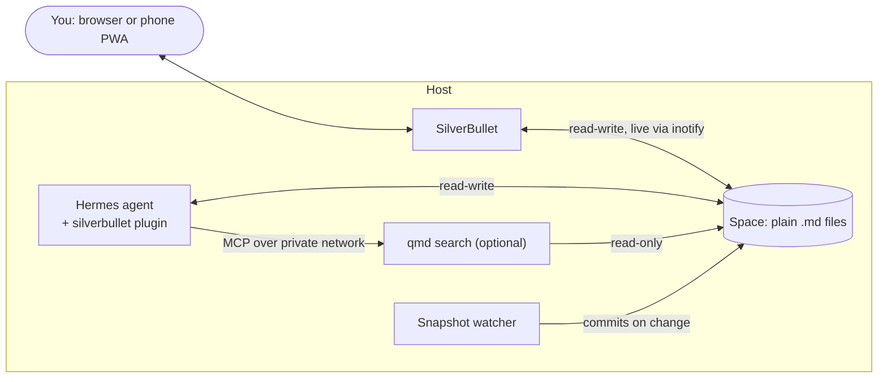

# hermes-silverbullet

Give [Hermes Agent](https://github.com/NousResearch/hermes-agent) a shared,
human-readable knowledge base: a [SilverBullet](https://silverbullet.md) space
that the agent edits with its ordinary file tools, and you watch update live in
your browser or on your phone.

There is no API adapter and no MCP server between them. The space is just a
directory of markdown files, mounted into the agent's container. Everything
interesting comes from three properties that combine well:

1. **Plain files on disk.** SilverBullet stores one `.md` file per page with no
   database, so the agent's `read_file`, `patch` and `search_files` work on
   notes directly, and you can version the space with git.
2. **Live in both directions.** SilverBullet watches the space with inotify, so
   a note the agent writes appears in an open editor without a reload. A note
   you type on your phone can be read by the agent a second later.
3. **Pages can be queries.** SilverBullet's `${query[[...]]}` blocks turn
   tags and frontmatter into live dashboards. Have the agent write structured
   frontmatter (`status: open`, `area: billing`) and its output sorts itself
   into views you never have to maintain.

What this repo adds is the part that makes an agent *use* the vault well: a
Hermes plugin with an always-on instruction to capture knowledge, skills for
editing and searching, and the host setup that keeps ownership and history
right.



## Install

Two parts: the **host** (mount the space, get ownership and history right),
then the **agent side** — the Hermes plugin, or the same files by hand for
other agents.

### 1. Host

```bash
cd host
sudo ./scripts/prepare-space.sh /srv/silverbullet/space 1000
cp .env.example .env    # set SB_USER, versions and paths
docker compose up -d silverbullet hermes
```

[`host/compose.yaml`](host/compose.yaml) is a reference layout, not a
requirement: what matters is that SilverBullet, the agent and the snapshot
watcher all see the same directory and all write as the same uid.

Then:

- **History:** install `inotify-tools` and enable the snapshot watcher from
  [`host/scripts/silverbullet-snapshot-watch.service`](host/scripts/silverbullet-snapshot-watch.service).
  SilverBullet has no page history; this commits the space about a minute
  after edits stop.
- **Docker terminal backend only:** merge the first block of
  [`host/hermes-config.snippet.yaml`](host/hermes-config.snippet.yaml) into
  Hermes' `config.yaml`. On the default `local` backend you can skip it.
- **Dashboard (optional):** copy [`vault/Hermes/_index.md`](vault/Hermes/_index.md)
  into the space.
- **Search (optional):** see [Search](#search-is-a-fallback-and-it-is-local).

### 2a. Hermes: the plugin

```bash
hermes plugins install pjrobot/hermes-silverbullet --enable
```

Then set who the notes belong to, and anything else that differs from the
defaults, in `config.yaml`:

```yaml
plugins:
  entries:
    silverbullet:
      settings:
        owner_name: Alex          # default "the user"
        notes_path: /notes        # where the agent sees the space
        agent_folder: Hermes      # the agent's own folder in the vault
        search_enabled: false     # true once the qmd MCP server is configured
```

Restart the gateway; the plugin applies from the next new session. It adds:

- **An always-on prompt section** rendered from [`prompt.md`](prompt.md). It
  has to be always on rather than a skill: "capture knowledge without being
  asked" must apply in sessions where notes are not the topic, which is when
  an on-demand skill would never load.
- **Two skills**, `silverbullet:notes-vault` and `silverbullet:qmd-search`.
  Plugin skills are not listed in the agent's skill index, so the prompt
  section names the one to load before writing.

### 2b. Other agents, or Hermes without the plugin

The same files work by hand: paste [`prompt.md`](prompt.md) into your agent's
persona or system prompt with the placeholders filled in, and give it the
[`skills/`](skills/) directory. They are standard `SKILL.md` files. Without
the plugin they are unnamespaced, so the prompt should say `notes-vault`.

## Why SilverBullet

The requirements were a real phone experience (offline-capable), notes stored
on the server as plain markdown files, and no database. SilverBullet is a
server that serves the space as files and a PWA with offline sync, so it meets
all three.

Obsidian is a strong editor, and Hermes even ships a skill for working on an
Obsidian vault folder — but Obsidian is a client app, so getting its notes onto
a server depends on a sync layer, and its self-hosted option (LiveSync) keeps
them in CouchDB rather than as files.

## Design decisions

### The vault is shared, so the agent says what it wrote

The prompt tells the agent three things: the vault is the user's knowledge
base and not its memory; it should capture hard-won knowledge there **without
being asked**; and it must **always say what it wrote and where**. Session
recall belongs in Hermes' memory provider; durable reference material goes in
the vault.

Capture is aimed at the things that are expensive to rediscover: a decision
and its reasoning, a gotcha that took an hour to diagnose, a measurement. It
is not a session log, and the prompt says so, because without that line the
agent narrates.

### Its own folder, for tidiness rather than permission

The agent writes under `Hermes/` by default, so its notes can be reviewed or
pruned as a group. Nothing confines it there: it is told to add to an existing
note of yours when that note already covers the topic, rather than starting a
parallel one you would later merge by hand.

The safeguard is **disclosure plus history**, not restriction. Every edit is
announced in the chat, and the snapshot watcher makes it recoverable.

### Frontmatter is the interface

Because SilverBullet queries frontmatter, anything the agent produces on a
schedule can land as one note per item with a `status:` key. A dashboard query
then lists the open ones, and you close an item by editing one line in the
same editor you take notes in. One note per item matters: each can be
handled without touching the others.

The same trick gives a recurring job state without a state file. If each run
records what it covered (`area: <package>`) in its note's frontmatter, the
next run can read the folder and pick the area visited least recently.

### Search is a fallback, and it is local

Hermes has no built-in document retrieval, so a vault past a few dozen pages
needs search. [qmd](https://github.com/tobi/qmd) does BM25, vector and
optional LLM reranking entirely on-device, and serves it over MCP.

The evidence so far is modest. In one test of 5 questions over ~110 markdown
files — with reranking off and the vector index incomplete — plain
`search_files` plus `read_file` found the right page every time, and qmd once
ranked a distractor first. So the skill makes file tools the primary path and
qmd the fallback for vague, concept-shaped questions. If your vault stays
small, leave qmd out.

To add it: seed `QMD_CONFIG_DIR` from [`host/qmd/index.yml`](host/qmd/index.yml),
`docker compose up -d qmd`, merge the `mcp_servers` block of
[`host/hermes-config.snippet.yaml`](host/hermes-config.snippet.yaml), add
[`host/qmd/refresh.sh`](host/qmd/refresh.sh) to cron (hourly), and set the
plugin's `search_enabled: true`.

## Gotchas

Each of these cost time to find.

- **Everything that writes must be the same uid.** SilverBullet cannot save a
  page owned by anyone else; it answers with a 500. Three things conspire
  against this:
  - SilverBullet's image ignores `PUID`/`PGID` (its entrypoint runs the binary
    directly), so without `user:` it runs as root.
  - With Hermes' **docker terminal backend**, file tools run inside the sandbox
    sidecar, which is root by default — every note the agent touches becomes
    uneditable. Set `terminal.docker_run_as_host_user: true`.
  - A default POSIX ACL on the space does **not** rescue this: Hermes' atomic
    write `chmod`s its temp file before moving it into place, which collapses
    the ACL mask.
- **The docker backend needs its own mount.** Without `terminal.docker_volumes`,
  a write to `/notes` "succeeds" into the sidecar's own filesystem, invisible
  to SilverBullet. Sidecars also outlive restarts, and Hermes reuses stopped
  ones: after changing either setting, run
  `docker ps -aq --filter label=hermes-agent=1 | xargs -r docker rm -f`.
- **`HERMES_WRITE_SAFE_ROOT` blocks the mount by default.** The image sets it
  to `/opt/data`, and `write_file`/`patch` fail outright outside it. Add the
  vault path (colon-separated) and keep `/opt/data`.
- **A missing bind-mount source does not fail.** dockerd creates an empty
  root-owned directory, and the agent writes into a folder SilverBullet is not
  serving, with no error. Check the path exists before starting.
- **Keep the space on local disk.** inotify sees changes made through the local
  mount, but not changes another machine makes over NFS, so live updates break
  as soon as two hosts share the space.
- **The space holds a secret.** `.silverbullet.auth.json` is SilverBullet's JWT
  signing key. Gitignore it, and know that mounting the whole space lets the
  agent read it.
- **Docker's published ports bypass ufw.** Bind SilverBullet to `127.0.0.1` and
  put a reverse proxy in front, and set `SB_USER`: empty means no login.
- **Turn off SilverBullet's shell backend** (`SB_SHELL_BACKEND=off`) unless a
  plug needs it: it lets plugs run commands in the container.
- **qmd has no watch mode, and `update` is not `embed`.** Run both on a timer.
  Without `qmd embed`, semantic search silently degrades to keyword search.
- **LLM reranking on CPU is impractical.** On an 8-core machine without a GPU
  it took 10–60 s per query and pegged every core; with `rerank: false` the
  same queries took ~5–40 ms. The search skill insists on `rerank: false`.

## Licence

MIT. The skills were written by the agent itself and edited for publication.
